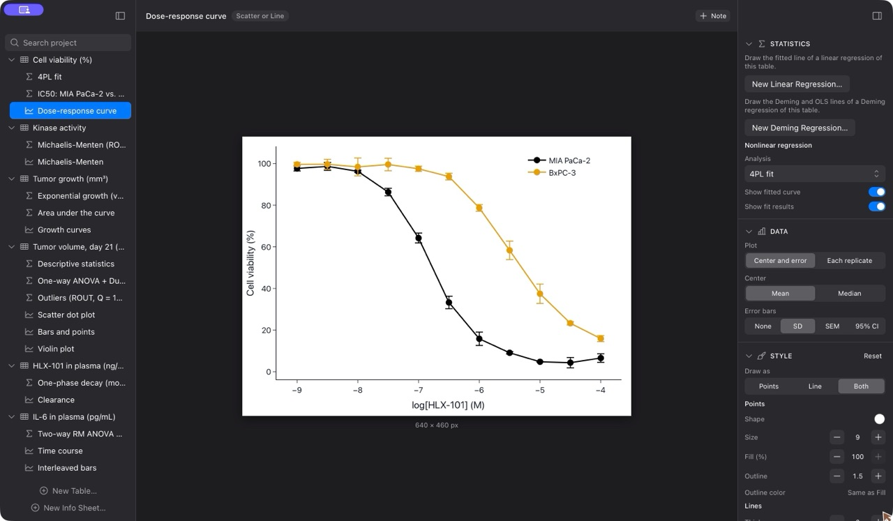
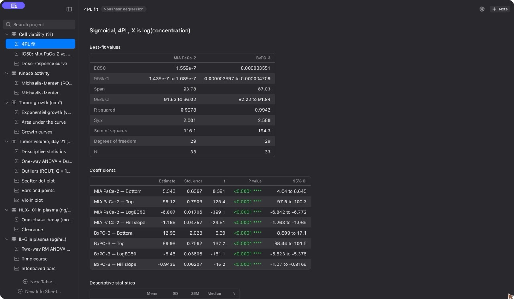
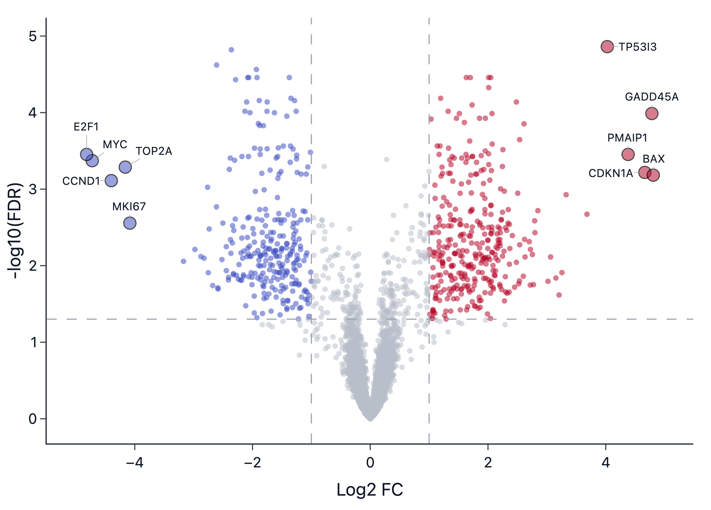
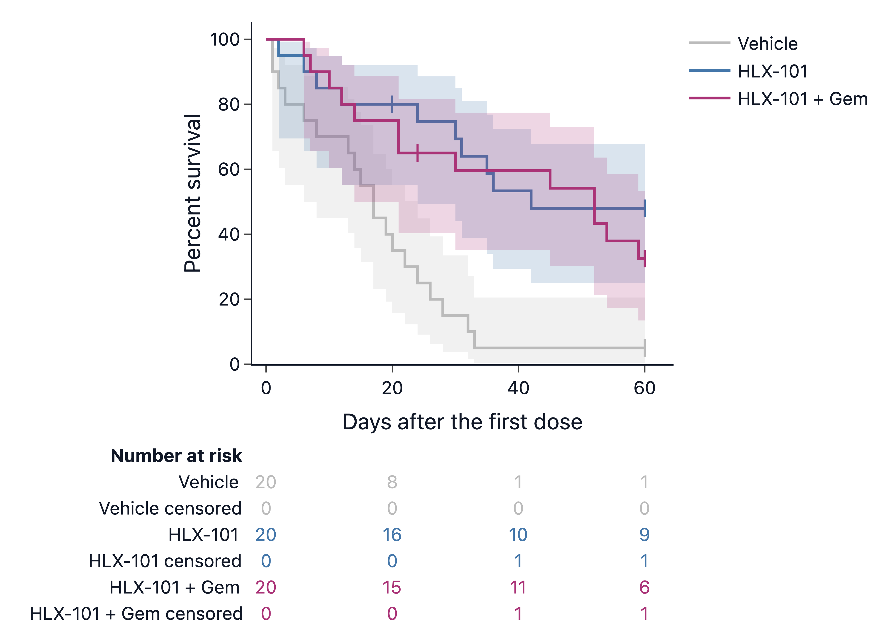
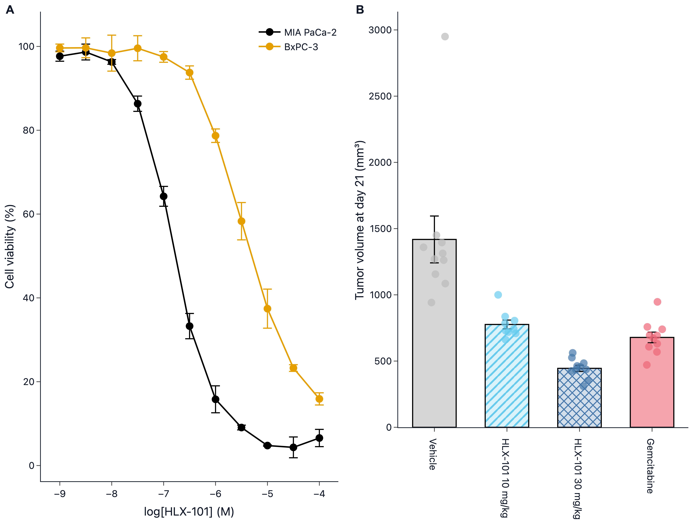

# Titer

**Scientific data analysis, simplified.**

Organize, analyze and visualize scientific data, from raw numbers to publication-ready
graphs. Titer is a free, open-source and private alternative to GraphPad Prism for Mac
and Linux.

Three engines do the work: a fast data grid built for Titer, **R**, the reference for
statistics (through [webR](https://github.com/r-wasm/webr), R compiled to WebAssembly), and
**[Plotly](https://plotly.com/javascript/)** for the graphs. Everything runs on your machine.



## About this fork

This is a modified fork of mickaphd/Helix,
the original Helix by mickaphd (© 2026 mickaphd). On top of upstream it adds
Prism-file import and write-back, a wider analysis catalogue, multi-panel figures, and bug
fixes — see the [release notes](https://github.com/smitpatel316/Titer/releases)
and the git history for what changed and when. Like upstream, it is licensed
under the [GNU General Public License](LICENSE), version 3 or later.

## Download

The latest release is **v1.6.2 for Mac** (Apple Silicon) and **v1.6.2 for Linux**.
Get them from the [Releases page](https://github.com/smitpatel316/Titer/releases):

| Build | File | Size | SHA-256 |
|---|---|---|---|
| Mac — Apple Silicon (v1.6.2) | [`Titer-1.6.2-aarch64.dmg`](https://github.com/smitpatel316/Titer/releases/download/v1.6.2/Titer-1.6.2-aarch64.dmg) | 103,842,225 bytes (~99 MB) | `6c38bdee248cef4bcdbbba16cc0945b3a6dccac8072890e77e190ebbb62a5651` |
| Linux (v1.6.2) | [`Titer-1.6.2-linux.AppImage`](https://github.com/smitpatel316/Titer/releases/download/v1.6.2/Titer-1.6.2-linux.AppImage) | 173,140,472 bytes (~165 MB) | `de78b6b726dc6ff61c675e6db209b82566f6c7ad5215cc73242586b2f985ef37` |
| Mac — Intel (latest: v1.2.0) | [`Titer-1.2.0-x64.dmg`](https://github.com/smitpatel316/Titer/releases/download/v1.2.0/Titer-1.2.0-x64.dmg) | 101,712,108 bytes (~97 MB) | `d8b6fcf88ffa52044279a2a8938b00f6821ca8c4abe35ef715c951ae36889456` |

Each release is cut from a tagged commit — the release notes name the exact
commit the downloads were built from, so the source for any download is retrievable
from this repo. Every download also includes a copy of the GNU GPL (`LICENSE`) and
the third-party notices (`THIRD-PARTY-NOTICES.md`).

Requires macOS 13.3 (Ventura) or later, or Ubuntu 22.04 or later for the Linux
AppImage (which needs `libfuse2` — `libfuse.so.2` — or run it with
`--appimage-extract-and-run`). On a Mac, open the DMG and drag **Titer** into the
**Applications** folder. Titer is signed ad hoc (not notarized by Apple), so macOS may ask you to confirm the first time you open it.

No Intel DMG ships in v1.3.0 or later — v1.2.0 above is the latest Intel build, and
it stays available for Intel Macs.

When a new version is out, Titer tells you (Titer › Check for Updates…). On a Mac
it downloads, verifies and installs the update for you, then relaunches with your
projects. On Linux the updater stops at a manual download of the new AppImage.

## What Titer does

Each **table** holds its own **analyses** and **graphs**. Change a value, and every result
and figure that uses it updates at once.

### Tables

Eight table types. Each guides how data are entered, and offers every analysis and graph
its data allow:

- **Column:** groups side by side (control, doses, treatments)
- **XY:** a response against a dose, a time or a concentration
- **Grouped:** groups across rows (time points, genes), with replicates
- **Nested:** clustered data, for nested t tests and nested ANOVA
- **Multiple Variables:** one row per subject, one column per variable
- **Contingency:** counts of outcomes
- **Survival:** one subject per row, its time, and whether the event happened

And a spreadsheet that feels like one:

- Copy and paste with Excel or Numbers, fill down, find, resize columns, keep the titles
  visible as you scroll
- Name each row (a mouse, a patient, a gene): the names follow into results and graphs
- Exclude a value from the analyses without deleting it
- Enter pre-calculated values as summary subcolumns (mean with SD, SEM or N), and change a
  table's error format between SD and SEM
- Extract and rearrange Multiple Variables tables; row means and totals with SD, SEM, %CV
  or confidence intervals

### Analyses

**55 analyses**, covering all 56 analyses in GraphPad Prism 10's catalogue. That
"56" is a catalogue mapping — every Prism 10 analysis has a Titer equivalent listed
below — not a single test-suite score. The numbers themselves are checked against
Prism's own saved results and against reference values: the frozen-tip suite passed
527/527 at v1.6.2 (see [VALIDATION.md](VALIDATION.md)).

- **Guided:** an assistant asks which data sets to analyze, whether they are
  paired and whether they follow a normal distribution (or checks it for you), then
  runs the right test
- **Every number comes from R**, the reference for statistics (webR, R 4.6.0)
- **Before you test:** normality and lognormality tests (Shapiro-Wilk, D'Agostino–Pearson,
  Anderson–Darling, Kolmogorov–Smirnov) that say in plain words which tests suit your
  data; outliers found by ROUT or Grubbs; descriptive statistics (including sum, skewness
  and kurtosis); frequency distributions; QQ plots of your data sets and residual plots
  of a regression to check the assumptions
- **Two groups:** one group against a value (one-sample t test, including lognormal),
  unpaired, Welch, paired, ratio and lognormal t tests, with Cohen's d and
  Hedges' g; Mann-Whitney, Wilcoxon matched-pairs, two-sample Kolmogorov–Smirnov
- **More groups:** one-way ANOVA (or Welch's, without equal SDs; of geometric means:
  lognormal), repeated-measures ANOVA with the Geisser-Greenhouse correction,
  Kruskal-Wallis, Friedman; two-way ANOVA (ordinary, with Dunnett, Games-Howell or
  corrected pairs; repeated measures with the Geisser-Greenhouse correction,
  Scheirer-Ray-Hare); three-way ANOVA; mixed-effects models (REML, Kenward-Roger);
  nested t test and nested one-way ANOVA; then every pair (Tukey, Bonferroni, Šídák,
  Holm–Šídák, LSD, Dunnett, Games-Howell, Dunnett's T3, Dunn) or each group against a
  control (Dunnett); multiple t tests with Holm or FDR correction
- **Counts:** Fisher's exact and chi-square tests, with the odds ratio, the relative risk,
  Phi and Cramér's V; chi-square test for trend (Cochran–Armitage); McNemar's test
- **Curves and regression:** dose-response (4PL, 3PL, 5PL) with the EC50 or IC50 (and the
  EC10, EC20, EC80 or EC90) and every parameter's 95% CI, several data sets at once or
  two curves compared, outliers left out by ROUT; dose-response special (EC50 shift,
  Schild pA2, operational model); nonlinear regression with compare-model F test and
  AICc, global/shared-parameter fits, weighting, parameter bounds and user-defined
  equations; standard curves read for your unknowns (ELISA); exponential, logistic and
  Gompertz growth, one- and two-phase decay (doubling time, half-lives),
  Michaelis-Menten, enzyme inhibition (including Morrison Ki), binding saturation,
  competition (Cheng–Prusoff Ki) and kinetics; spline and Lowess; simple and multiple
  linear regression; simple and multiple logistic regression; Poisson regression; Deming
  regression; correlation (Pearson, Spearman) with 95% CIs, and correlation matrices;
  area under the curve; plot a function; smooth, differentiate and integrate
- **Survival:** Kaplan-Meier with median survival, log-rank, trend and Gehan-Breslow-Wilcoxon
  tests, hazard ratios, and Cox regression; Number at Risk shown under the curve
- **Multivariate and simulation:** principal component analysis (with scree plot and biplot),
  K-means clustering, hierarchical clustering (with dendrogram, Elbow, Silhouette and Gap plots),
  ROC curves, Bland–Altman, Monte Carlo simulation
- **Data operations** (not analyses, but shipped): transform data, transform concentrations,
  remove baseline, normalize — as live computed tables that follow their source and can
  be analyzed and graphed — transpose, prune rows, fraction of total
- **Beyond Prism:** plot-a-function, and row means/totals have no Prism
  equivalent
- **Clear results:** the exact test that ran, whether it is significant, every statistic,
  multiple comparisons and descriptive statistics, ready to copy
- Analyses follow the data: rename a column and they follow it, edit a value and they run again



### Graphs

**37 graph types**, all drawn from your tables and analyses:

- **Column and grouped data:** dot plots, before-and-after plots, box and violin plots,
  mean-with-error plots, grouped bars, grouped scatter, grouped before-and-after,
  grouped lines, grouped stacked bars, grouped horizontal bars, grouped box plots
- **XY data:** scatter, bubble plots, bars, area, smooth curves, logistic curves
- **Specialized:** heatmaps, volcano plots, survival (Kaplan–Meier) curves, forest plots,
  estimation plots, Bland–Altman plots, ROC curves, Schild plots, observed-vs-fitted
  plots, pie and donut charts, histograms, scree plots, PCA biplots, K-means scatter
  plots, dendrograms, Elbow, Silhouette and Gap plots, Monte Carlo histograms

- **Ready for a paper by default**
- **Statistics on the graph:** significance stars, P values or group letters from your
  analyses, regression lines with their confidence or prediction band and equation, any
  fitted curve with its best-fit values, Kaplan-Meier curves with their confidence band
  and the number at risk
- **Notes and tags on everything:** a note on each table, analysis and graph, and the
  Finder's color tags to find them in a busy project, saved in the project
- **One table, many figures:** a graph shows all of a table's data sets or only those you
  tick, each in the same color everywhere; its stars come from an analysis of them
- **Colors that work:** 15 palettes from the scientific literature (Okabe-Ito, Paul Tol,
  Viridis, Batlow…), colorblind-friendly ones first, each reversible; or make your own,
  kept on your machine
- **Style every series:** color, point shape, dashed lines, fill patterns; and the whole graph:
  fill opacity, outlines, error bars (thickness, caps, color, direction)
- **Style single points:** click or drag over them to change their color, shape or size, or
  show their name; on a volcano plot, find genes by name
- **A second Y axis:** plot a second data set on the right axis, linear, log10 or log2
- **Match:** give a graph the look of another one, choosing what it takes; **Batch Magic**
  applies that Match formatting to many graphs at once; **Clone** copies a graph
- **Lay it out:** move the legend and notes, resize by dragging an axis or typing a size, set
  each axis's range and step, draw reference lines (a control's level, a threshold) with
  their text, gridlines (none, major, or major + minor, per axis) and tick
  direction, length and interval, white or transparent background
- **Export** as PNG, JPG, SVG, PDF or TIFF at 150, 300, 600, 900 or 1200 DPI, at their true
  printed size; or copy and paste into Keynote, PowerPoint or Word; or send a graph
  straight to Word or PowerPoint in one click





### Figures

**Multi-panel figures:** combine several graphs into one figure with a shared legend,
panel labels and one export — the figure for a paper, built from the same live graphs.



### Prism file compatibility

Titer reads and writes GraphPad Prism files, so existing Prism projects move over
without retyping data.

- **Open Prism files:** File › Import Prism File… opens `.pzfx` (Prism 5–9),
  `.prism` (Prism 10) and `.pzf` (Prism 4/5, legacy binary). A `.prism` file brings in its data tables, analysis parameters
  and info sheets; graphs and layouts are not transferred, and results are recomputed
  from the data on open. A `.pzf` file brings in its data tables (as Column tables —
  the legacy format records no table type) and info sheets; analyses, graphs and
  layouts are not transferred.
- **Save back to Prism:** the save prompt offers Save as `.prism` (Prism 10) or Save as
  `.pzfx` (Prism 5–9). The writers cover data tables, analysis parameters and info
  sheets (`.prism`) or data tables and info sheets (`.pzfx`) — never graphs, layouts or
  results. Nested and Multiple Variables tables refuse the write with a named error
  rather than silently dropping data.
- **Checked by round-trip:** `.pzfx` → Titer → `.pzfx` → Titer comes back cell-identical
  on all 10 test fixtures (values, row titles, column names and order, excluded cells,
  date X, X error, summary subcolumns), and `.prism` round-trips cell-identical on the
  demo file with identical analysis parameters. Every written `.pzfx` file validates
  against the Prism 8 XSD.
- **One thing not yet proven:** v1.6.2 fixed the two known ways real Prism rejected
  files Titer wrote (a `.prism` open crash, a `.pzfx` XML-compliance warning), but
  whether Prism itself opens a file Titer wrote is still being verified — the round-trips
  above go through Titer's own importer, not through Prism, and the real-Prism check is
  running now. Don't take "Prism opens Titer files" as given until that check is done.
- **Titer's own format** is plain JSON (`.hlx`), described in
  [FILE-FORMAT.md](FILE-FORMAT.md), so your data are never locked in. Open methods: how
  each analysis is computed and checked is in [METHODS.md](METHODS.md).

### Automation and organization

- **Prism scripts:** automate Titer without programming, using Prism-script commands
  (ExportTIF/BMP/CSV/TXT are supported; Windows-only and legacy Prism commands are
  documented as unsupported)
- **Info sheets:** hold project constants that analyses and fits read live — edit a
  constant and the fit re-runs
- **Templates:** save a project or a method as a reusable template (`.pzt` / `.pzm`),
  from File › Save As Template / Example / Method
- **Magic Wand:** describe the analysis or graph you want and it plans the steps
- **Project search** with highlighting, **floating notes** pinned to sheets,
  **frozen results** (keep a result as it was), **duplicate a family**
- **Try it:** Help › Sample Project opens a made-up study told as a paper's figures, from cells
  to mice to patients, with every kind of table ([also here](samples/Titer%20Sample.hlx)).

### Projects

- A native desktop app: real menus and shortcuts, light and dark mode, your accent color,
  resizable sidebar and inspector
- Undo and redo everything, across the whole project
- Several projects at once, each in its own window; the ones still open when you quit come
  back at the next launch
- Open projects: a Titer file (`.hlx`) is plain JSON, described in
  [FILE-FORMAT.md](FILE-FORMAT.md), so your data are never locked in
- Open methods: how each analysis is computed and checked is in [METHODS.md](METHODS.md)

### Cloud storage — Box

Titer can open, edit and save `.hlx` and `.prism` files in Box, from Settings →
Connected Storage. It detects conflicts and never silently overwrites, and tokens live
in your operating system's keychain, never in a file.

Connect with **your own Box app** (your client id and secret — there is a toggle,
"Always use my own Box app"). The shared Titer Box app for one-click connect is not
live yet, so bring-your-own is the working path for now. Dropbox, OneDrive and Google
Drive are not connected yet.

## Use Titer with your AI assistant (MCP)

MCP lets an AI assistant you already use — Claude Code, Claude Desktop, or OpenCode — drive
Titer directly: open projects, run analyses, build graphs, export files. The assistant talks
to a small server that runs only on your machine.

1. **Turn it on.** In Titer, go to Settings → AI Connections and turn on "Allow AI apps to
   connect". The server is off until you do this. Leave Titer running while you use your
   assistant — if you quit Titer, the tools stop answering until you reopen it.

2. **Connect your assistant.**

   **Claude Code** — in Titer's AI Connections dialog, copy the setup command and run it once
   in a terminal. It looks like this — but copy yours from the dialog, which fills in your
   real address and token; don't type this line by hand:

   ```sh
   claude mcp add --transport http --scope user titer http://127.0.0.1:18741/mcp --header "Authorization: Bearer <your-token>"
   ```

   New Claude Code sessions will see the Titer tools — check with `/mcp`.

   **Claude Desktop** — add the bridge that ships inside the Titer app to
   `~/Library/Application Support/Claude/claude_desktop_config.json`, under `mcpServers`:

   ```json
   {
     "mcpServers": {
       "titer": {
         "command": "/Applications/Titer.app/Contents/MacOS/titer-stdio-bridge",
         "args": [],
         "env": {}
       }
     }
   }
   ```

   Then fully quit Claude Desktop and reopen it. (A one-click `.mcpb` install is coming in a
   later release.)

   **OpenCode** — add this to `~/.config/opencode/opencode.json`:

   ```json
   {
     "$schema": "https://opencode.ai/config.json",
     "mcp": {
       "titer": {
         "type": "local",
         "command": ["/Applications/Titer.app/Contents/MacOS/titer-stdio-bridge"],
         "enabled": true
       }
     }
   }
   ```

   Check it connected with `/mcps` or `opencode mcp list`.

   **Codex and Google Antigravity** also connect — see [docs/codex.md](docs/codex.md) and
   [docs/antigravity-setup.md](docs/antigravity-setup.md) for their setup
   (deep reference: [docs/antigravity.md](docs/antigravity.md)).

3. **Ask it things**, for example:

   - "Open my dose-response project and run a one-way ANOVA on the XY table."
   - "Build a scatter graph from that table and export it as a 300 DPI PNG."
   - "What analyses have I run on this table, and which are significant?"
   - "Is my Box account connected?"

**Good to know:** the server only listens on your own machine (`127.0.0.1`) and never sends your
data anywhere. It uses a private token — keep it private, and if you regenerate it in Settings,
reconnect your assistant. It offers 51 tools: 14 only read, 37 can change your project (run an
analysis, build a graph, export, save, delete) — your AI tool's own approval settings decide
when it asks first. Box cloud tools need a Box account connected in Settings → Connected
Storage; without one they tell you to connect first.

## Privacy

Titer works entirely on your machine: your data never leave it, and there is no
telemetry in the app. Its only connections are a daily check on GitHub for a newer version,
and Box traffic when a Box account is connected. The MCP server listens on your own
machine only (`127.0.0.1`) and makes no outbound connection.

## Building from source

You need [Node.js](https://nodejs.org) 24 or later, [Rust](https://rustup.rs), and the
Xcode Command Line Tools (`xcode-select --install`).

```bash
npm ci            # install
npm run dev       # run Titer with live reload
npm test          # check every analysis and graph against their reference results
npm run build     # build the Mac DMGs (only Apple Silicon is published since 1.3.0)
```

Building the Mac DMGs needs both Mac targets for Rust, once:
`rustup target add aarch64-apple-darwin x86_64-apple-darwin`.

## Clean-room note

Titer's GraphPad Prism file support (`.pzfx` import, `.prism` import, `.pzf` import, and `.prism` /
`.pzfx` write-back) was built clean-room: by studying the files Prism writes, together
with public documentation and the open-source readers for those formats (R's `pzfx`
package and Python's `pypzfx` — both `.pzfx`-only; the `.pzf` grammar was
reverse-engineered from two real public `.pzf` files, since no spec or reader exists
for it), and implementing the importers and writers independently
from those observations. No part of it involved decompiling, disassembling,
or otherwise reverse-engineering Prism's program, and no cracked or pirated
Prism source was used. Where the internal structure of a file was unclear,
it was probed by changing one thing at a time in a Prism-written file and
observing what changed inside the file — never by touching the program. The
importers and writers are independent implementations and contain no Prism code.

## License

Titer is free software: you can redistribute it and modify it under the terms of the
[GNU General Public License](LICENSE), version 3 or later. It comes with no warranty.

© 2026 mickaphd

Titer is free and always will be. If it saves you time, you can [buy the developer a coffee](https://www.buymeacoffee.com/smitpatel316).

## Acknowledgments

Titer stands on the shoulders of [R](https://www.r-project.org) and
[webR](https://github.com/r-wasm/webr), which bring R to the app, R's
[survival](https://github.com/therneau/survival) package for survival analysis,
[Plotly.js](https://plotly.com/javascript/) for the graphs, [Phosphor Icons](https://phosphoricons.com)
for its icons, and [Tauri](https://tauri.app) and [React](https://react.dev) for the app itself. See
[THIRD-PARTY-NOTICES.md](THIRD-PARTY-NOTICES.md) for all of them and their licenses.

GraphPad Prism is a trademark of GraphPad Software, LLC. Titer is an independent project,
not affiliated with or endorsed by GraphPad Software.
